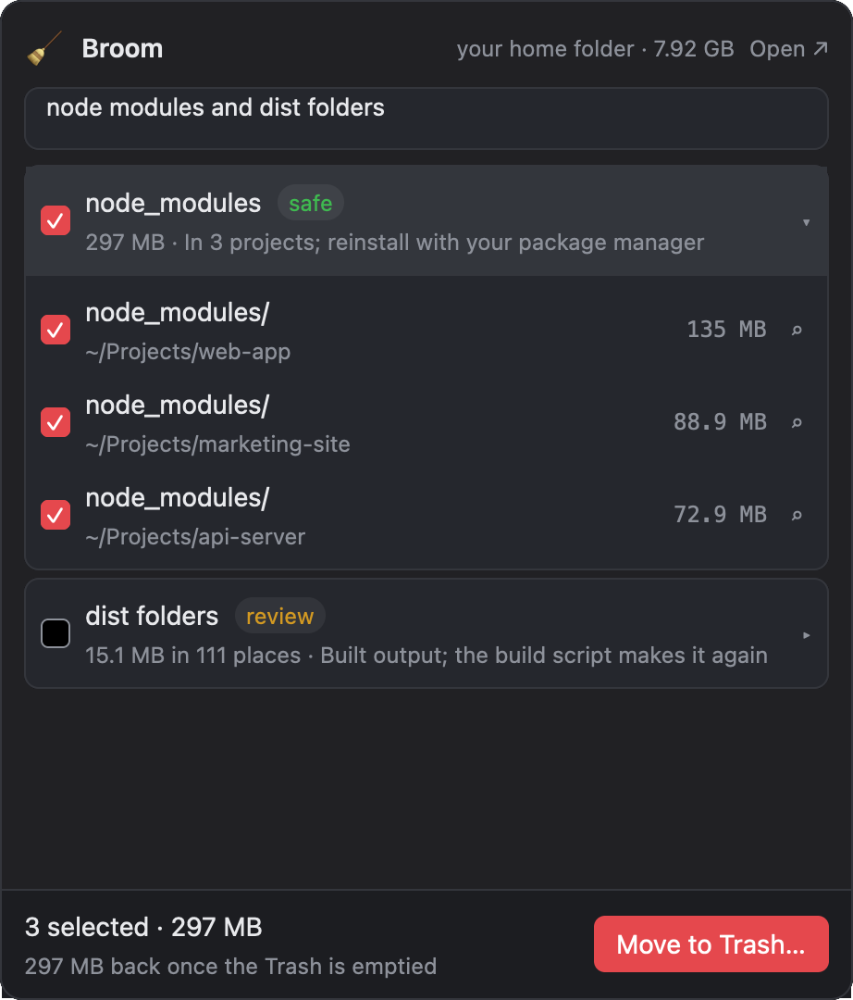
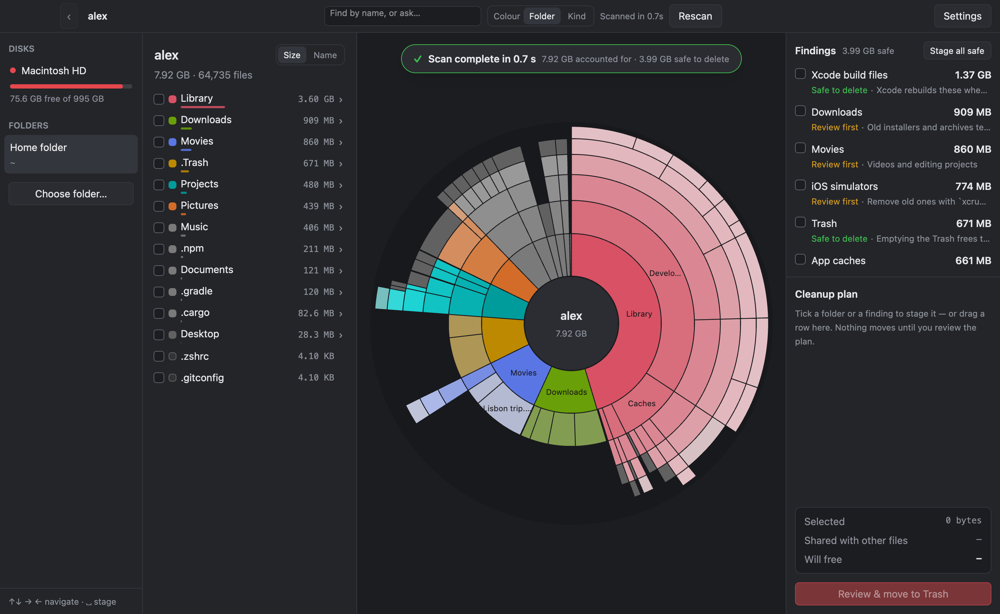

<p align="center">
  
</p>

<h1 align="center">Broom</h1>

<p align="center">
  <b>Ask your Mac what's eating the disk. Tick what should go. Trash it.</b><br>
  A menu-bar panel that understands plain English, over a fast, exact disk explorer with a live sunburst.<br>
  Native macOS, written in Rust, GPU-rendered, no analytics, nothing leaves the machine but the question you typed.
</p>

<p align="center">
  <a href="https://github.com/sriinnu/broom/actions/workflows/ci.yml"></a>
  
  
  <a href="LICENSE"></a>
</p>

---

Click the 🧹 in the menu bar and type what you mean: *node modules*, *all dist folders*,
*old dmg files in downloads*, *worktrees*, *xcode junk*. Broom turns that into groups of folders it
found on the last scan, labels each one **safe** or **review**, shows what deleting them really frees,
and moves what you tick to the Trash. Nothing is deleted outright.

The main window is the full picture: a sunburst of the disk that draws while the scan runs, findings
for the usual space hogs, and a cleanup plan you stage with checkboxes before anything moves.

<p align="center">
  
</p>

<p align="center">
  
</p>

<sub>Both screenshots use a made-up home folder generated by
[`scripts/make-demo-home.py`](scripts/make-demo-home.py), not anyone's real files.</sub>

## What it does

**Find what's big**
- **Ask in plain words** from the 🧹 menu bar: *node modules*, *old dmg in downloads*, *xcode junk*
  (Telugu works too: *node modules anni teesey*).
- **A live sunburst** of the disk that fills in while it scans. A whole Mac in about 25 s, a home
  folder in seconds ([numbers](docs/PERFORMANCE.md)).
- **Findings** for the usual space hogs: Trash, Downloads, Xcode, app caches, npm, Cargo, Gradle,
  Maven, Mail, duplicates and more.
- **Developer caches, project by project.** `node_modules`, build outputs (`target`, `.next`,
  `Pods`, …) and Python environments, each listed per project. A build folder only counts with its
  tool's file beside it (`target` next to `Cargo.toml`), never when git tracks it. Projects you
  touched this week stay unticked.
- **Where is my space?** (View menu) The disk as lines that add up, each marked measured,
  computed, estimated or unknown. Snapshots named for what they are.
- **What grew** since your last scan, in amber beside each folder.

**Clean it safely**
- **Every item says why:** *Safe to delete*, *Review first*, or *Use its tool* (Docker, Go
  modules, Rust toolchains, Ollama: no checkbox, just the command that cleans them properly).
- **Nothing is deleted outright.** You stage a plan, review the list, and it goes to the Trash.
  **Put Back** works.
- **The real number.** What a delete frees counts clones and hard links once, so it never
  promises space that won't come back.
- **Empty Trash** (⇧⌘⌫) says what's there first, then shows how much the disk actually gained.
- **Merge as Clones** turns duplicate files into APFS clones: every file stays, the space comes back.
- **Never offer this.** Right-click › Never Offer This, or Settings › Protected. Broom, and any
  agent using the CLI, will never move it, or anything holding it, to the Trash.

**And**
- Native macOS, written in Rust. No analytics; it only reads file metadata.
- An optional AI reader double-checks what you meant. It sees folder names, never full paths, and
  Broom works fully without it.
- Five looks (Settings › Appearance), and a small investigator who comments while it scans.

**Known limit:** files that share storage (APFS clones, hard links) are counted once per file in
folder totals, so a whole-disk scan can read a little above the disk's size. **Where is my space?**
shows how much. A fix is planned.

## Install

### Homebrew

```bash
brew install sriinnu/tap/broom
```

That installs **Broom** into /Applications and puts the `broom` command on your PATH. `brew upgrade`
picks up new releases; `brew uninstall --zap broom` also removes its settings.

### Build from source

**You need:** macOS 13 or later on Apple silicon, the Xcode Command Line Tools
(`xcode-select --install`), and [Rust](https://rustup.rs). The toolchain is pinned in
`rust-toolchain.toml`, so `rustup` fetches the right version.

```bash
git clone git@github.com:sriinnu/broom.git
cd broom
scripts/bundle.sh
```

That builds `dist/Broom.app`, signed ad hoc, so it runs on the Mac that built it. Drag it into
**Applications** and open it. `scripts/bundle.sh --dmg` also makes a disk image, and
`scripts/deploy.sh` builds and installs straight into /Applications.

Or run it from the source tree:

```bash
cargo run --release
```

### Releases

Tagged releases are built, signed with a Developer ID, notarized by Apple and published by the
Release workflow; see [docs/RELEASING.md](docs/RELEASING.md). Download the DMG from the
[Releases page](https://github.com/sriinnu/broom/releases), open it, drag **Broom** into
**Applications**. Each release lists its SHA-256 in `SHA256SUMS`, and
`gh attestation verify Broom-<version>.dmg -R sriinnu/broom` checks it was built by that workflow.

### Full Disk Access

macOS keeps some folders private (Mail, Messages, Safari, other apps' data) unless an app has Full
Disk Access. Broom works without it, shows exactly how much it couldn't read, and offers a button
that opens **System Settings › Privacy & Security › Full Disk Access**. Turn Broom on there; Broom
notices within a couple of seconds and offers to rescan. Access is tied to the app's signature, so a
rebuilt ad-hoc app has to be granted again.

When you run Broom from a terminal (`cargo run`), macOS asks about the terminal app instead.

### The reader (optional)

Broom's own matcher handles the common questions on its own. To turn on the classifier, open
**Settings › API keys** in the app and paste a key; it goes into the macOS keychain, never a file.
Under `cargo run`, the environment works too:

| Variable | Used for |
|---|---|
| `TYPESAFE_API_KEY` (or `JEV_API_KEY`) | Jev, the yes/no reader: "is this group what they asked for, and is it safe?" |
| `LAYA_API_KEY` (or `AI_GATEWAY_API_KEY`) | a chat model for free-form questions; `LAYA_BASE_URL` and `LAYA_MODEL` override the endpoint |

## Using Broom

**Menu bar.** Click 🧹 to open the panel (the number next to it is how full the startup disk is).
Type, then tick. `Enter` asks the reader when one is configured, `Esc` closes. Right-click or
ctrl-click the 🧹 for the menu: open the window, rescan, quit.

**Window.** Pick a disk or folder on the left. Hover a slice or a row to see its size; click to zoom
in; click the centre, or use the breadcrumbs, to go back up. Tick a folder or a finding to stage it,
or drag it onto the plan. The search box at the top takes the same questions the panel does.

Sort the list by Size, Name or Modified; click the same one again to flip it (↓/↑, A–Z/Z–A,
Newest/Oldest). Drag the edge of any column to resize it; double-click the edge to reset it. The ⎘ by
the breadcrumbs copies the open folder's path, and hovering a path that's cut short shows all of it.

Broom remembers each scan (folder sizes only, for a week), so scanning the same place again shows
what grew since: `+1.2 GB` in amber beside a folder, shrinkage in green. Once a scan finishes,
identical copies of your own files show up as a **Duplicate files** finding (compared byte for
byte; APFS clones and hard links don't count, since deleting them frees nothing), with **Merge as
Clones…** beside it. After a move to the Trash, the banner has **Put Back** and **Empty Trash…**.

| Keys | Action |
|---|---|
| ⌘F | Search or ask |
| ↑ ↓ | Move the selection |
| → or Enter | Open the selected folder |
| ← , ⌫, Esc or ⌘↑ | Go to the enclosing folder |
| Space | Stage or unstage the selected row |
| ⌘C | Copy the selected row's path (or the open folder's) |
| ⇧⌘C | The same, with your home folder as `~` |
| / | Search or ask |
| ⌘1 ⌘2 ⌘3 | Sort by size, name, date modified (again to flip) |
| ⌘[ ⌘] | Back and forward through the folders you've visited |
| ⌃⌘S (or ⌥⌘S) | Hide or show the sidebar |
| ⌥⌘0 | Hide or show the findings and cleanup column |
| ⇧-click, ⌘- or ⌃-click, ⌘A | Pick a range of rows, add or remove one, or take them all; space and ⌘C act on all of them, esc lets go |
| ⌘O | Choose a folder to scan |
| ⌘R | Rescan: re-reads only the folders macOS says changed since the last scan |
| ⇧⌘R | Full rescan, reading everything again |
| ⇧⌘D | Back to the Disks screen |
| ⇧⌘⌫ | Empty Trash… (asks first) |
| ⌘, | Settings, in its own window |
| ⌘W, ⌘M, ⌘H | Close (Broom stays in the menu bar), minimize, hide |
| ⌘Q | Quit |

You can also pass a folder on the command line: `broom ~/Library`. Broom runs as one instance: a
second launch hands its folder to the running one, brings it forward and exits.

## From a terminal, or an agent

The same scanner, ask engine and safety rules, without the window. Everything goes to the Trash,
never deleted outright; `clean` and `trash` are dry runs unless you add `--yes`. `--json` puts one
object on stdout for a program to read, progress stays on stderr.

```bash
broom scan                                  # home folder: totals, biggest folders, findings
broom scan ~/Library --json
broom find node modules and dist folders    # the groups the panel would show, with every path
broom find worktrees --root ~/Code --json
broom clean node modules                    # dry run: what would go, and what it frees
broom clean node modules --yes              # safe, precise groups only
broom clean old dmg in downloads --all --yes   # include "review" groups too
broom trash ~/Projects/x/node_modules ~/Library/Caches/pnpm --yes
```

`find --json` returns `groups[]` with `label`, `safety` (`safe` or `review`; findings in `scan` can also be `manage`, meaning use its own tool), `precise` (a name,
finding, extension or worktree match rather than a substring or kind guess), `bytes` and
`folders[]` of `{path, bytes, items}`. An agent reads that, decides, and calls `trash` with the
exact paths it wants; `clean --yes` is the shortcut for "everything precise and safe". `--ask` on
`find` or `clean` also consults the configured reader and reports its answer. The CLI refuses the
disk root, system folders, volumes, your home folder and its standard folders, and any Trash.

**Agents can only move things to the Trash.** Nothing on this side deletes for good, empties the
Trash or rewrites files; those stay in the window, behind a confirm a person clicks. A test reads
the CLI's code and fails the build if that ever changes.
Anything in Settings › Protected is refused too, and `broom scan` lists what it left out.
Exit codes: 0 done, 1 something failed (partial failures list what didn't move), 2 usage.

## How it works

```
src/
├── main.rs        app setup, menus, key bindings, command-line flags
├── cli.rs         headless scan / find / clean / trash for scripts and agents
├── app/           the window, one file per part: disks rail, folder list, sunburst, findings, cleanup plan, review
├── panel.rs       the menu-bar panel: query, groups, ticks, confirm, trash
├── menubar.rs     the NSStatusItem (objc2), its menu, and where to hang the panel
├── ask/           turning a question into groups: tokens, folder words, findings, worktrees,
│   ├── mod.rs       patterns, kinds; dedupe; safety; the provider interface
│   ├── jev.rs       Jev (typesafe.ai) yes/no questions per group
│   └── laya.rs      chat-completion second opinion
├── classify/      what kind of thing a path is (apps, caches, photos…), colours the chart by kind
├── comic.rs       the investigator and the captions
├── trashcan.rs    the drop, the move to the Trash (the one door, protect-checked), Empty Trash
├── protect.rs     Settings › Protected: what may never be offered or moved
├── duplicates.rs  duplicate files, and merging them into APFS clones
├── space.rs       "Where is my space?": the disk's ledger and its snapshots
├── single.rs      one Broom at a time: a Unix socket in the state folder hands a second launch over
├── scan.rs        parallel walk (outline → hotspots → depth-first), the flat Tree, names index, frees_of
├── scan/catchup.rs bringing a kept tree up to date from the folders that changed
├── cache.rs       the last scan of each root, kept on disk so a relaunch shows it at once
├── fsevents.rs    which folders changed since a given moment, from macOS's FSEvents history
├── refresh.rs     full scan or catch-up, and storing the result
├── delight.rs     the swept count, real-world comparisons, scanning asides, Reduce Motion
├── dirlist.rs     getattrlistbulk/openat directory listing, with a portable fallback
├── live.rs        live per-folder totals during a scan, snapshots
├── disk.rs        the startup disk's APFS container: exact slices for the other volumes
├── findings.rs    the catalog of known space hogs, build outputs, and how to recognise them
├── sunburst.rs    layout in angle space, painting, polar hit-testing
├── theme.rs       the five themes: palettes for light and dark, radius, fonts, the six-hue ladder
├── settings.rs    settings file and state dir
├── secrets.rs     keychain
├── onboarding.rs  first run and Full Disk Access detection
├── motion.rs      easing segments between live snapshots
├── eta.rs         progress and "about N s left"
├── clock.rs       the UI clock (lets the recorder pause time)
└── snapshot.rs    dev tool: scripted input, screenshots and video recording
```

1. **Outline.** The first two levels are listed by name in about 10 ms, so the chart has a shape at once.
2. **Hotspots.** Known space hogs are read next, in parallel, so findings and the biggest slices are
   exact within a couple of seconds even on a full disk.
3. **Main walk.** Everything else, depth-first across all cores. Folders in the top levels keep
   atomic running totals the UI snapshots ten times a second.
4. **Kept.** A scan that took more than a second and a half is kept on disk with the FSEvents
   id from when it began. The next launch shows it at once, labelled with its age, and catches up by
   re-reading only the folders macOS logged as changed; anything it can't vouch for gets a full scan.
5. **Results.** The finished tree is a flat array of nodes with a lowercase name index, which is
   what makes a panel query over two million nodes answer in well under a second. Findings resolve
   their exact savings afterwards, one at a time on a small pool so they never starve the UI.
6. **Ask.** A query becomes tokens (stop words in English and Telugu dropped, phrases normalised),
   then groups: findings by alias, folder words from a table that knows which names need a manifest
   next to them to count as safe, extensions, worktrees (a folder whose `.git` is a file), glob
   patterns and kinds. Overlapping groups collapse to the most precise. If a reader is configured,
   it votes on each group and is only trusted above a confidence floor.

The UI is built with [GPUI](https://github.com/gpui-ce/gpui-ce) (the community edition of the
framework behind the Zed editor), which renders everything on the GPU with Metal. The menu-bar item
is an `NSStatusItem` through objc2, and the panel is a non-activating panel window hung under it.

## Development

```bash
cargo test                                        # unit tests, including the ask engine
cargo test -- --ignored                           # plus the APFS clone-accounting test (creates and deletes a small disk image)
cargo run --release -- --bench-scan ~/Library 6   # headless scan benchmark (median of 6)
cargo run --release -- --bench-live ~/Library 3   # how soon the live chart looks right
cargo run --release -- --check-access             # does this process have Full Disk Access?
```

`bench/ab.sh` runs two builds alternately and compares their medians. See
[docs/PERFORMANCE.md](docs/PERFORMANCE.md).

Dev hooks: `BROOM_OPEN_PANEL=1` pops the panel shortly after launch, `BROOM_PANEL_QUERY=…`
pre-fills it, `BROOM_MB_DEBUG=1` logs menu-bar and query timings and the paths sent to the Trash,
`BROOM_NO_SINGLETON=1` lets a second instance run (snapshot and video runs are exempt anyway).

### Screenshots and video without Screen Recording permission

With `--features snapshot`, Broom drives its own windows from a script and saves PNGs, or records a
video (needs `ffmpeg`). The screenshots above were made like this:

```bash
scripts/make-demo-home.py /tmp/demo
HOME=/tmp/demo/alex BROOM_HIDE_ACCESS=1 BROOM_SNAPSHOT=/tmp/shots/readme \
BROOM_SCRIPT="until-done 40; wait 2; shot main; panel; wait 1.5; panel-type node modules and dist folders; wait 5; panel-shot panel; quit" \
cargo run --release --features snapshot -- /tmp/demo/alex
```

Steps: `wait S`, `shot NAME`, `burst NAME COUNT MS`, `move X Y`, `click`, `hover`, `glide X Y S`,
`until-done MAX`, `about`, `panel`, `panel-type WORDS`, `panel-click X Y`, `panel-shot NAME`,
`panel-burst NAME COUNT MS`, `slow-motion N`, `hide-pointer`, `show-pointer`, `quit`. Coordinates are points within the window. For video, set
`BROOM_VIDEO=/tmp/broom.mp4` instead of `BROOM_SNAPSHOT`.

### Packaging for other Macs

`scripts/bundle.sh` signs ad hoc by default. To distribute, sign with a Developer ID and notarize:

```bash
BROOM_SIGN_ID="Developer ID Application: Your Name (TEAMID)" BROOM_NOTARY_PROFILE=broom-notary scripts/bundle.sh --dmg
```

(Save the notary profile once with `xcrun notarytool store-credentials broom-notary`.) The Release
workflow does the same from repository secrets; see [docs/RELEASING.md](docs/RELEASING.md).

### The icon

`scripts/make-icon.py` draws the investigator in ligne claire (flat fills, one contour weight, no
gradients or gloss) with the character's own palette from `src/comic.rs`, and builds
`packaging/AppIcon.icns` plus a size sheet:

```bash
uv run --with pillow python3 -I scripts/make-icon.py packaging
```

## Credits

- Broom is inspired by [Petal](https://github.com/henrydennis/petal) by Henry Dennis, and started
  as a fork of it.
- The sunburst idea goes back to [DaisyDisk](https://daisydiskapp.com). Broom is an independent
  project, not affiliated with it.
- Built on [GPUI CE](https://github.com/gpui-ce/gpui-ce), [rayon](https://github.com/rayon-rs/rayon),
  [objc2](https://github.com/madsmtm/objc2), [palette](https://github.com/Ogeon/palette) and
  [trash](https://github.com/Byron/trash-rs).

## License

[MIT](LICENSE)
