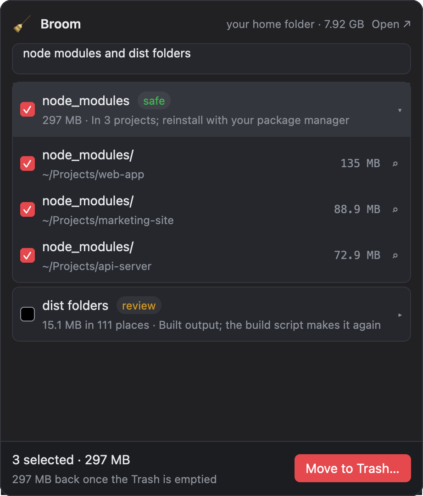
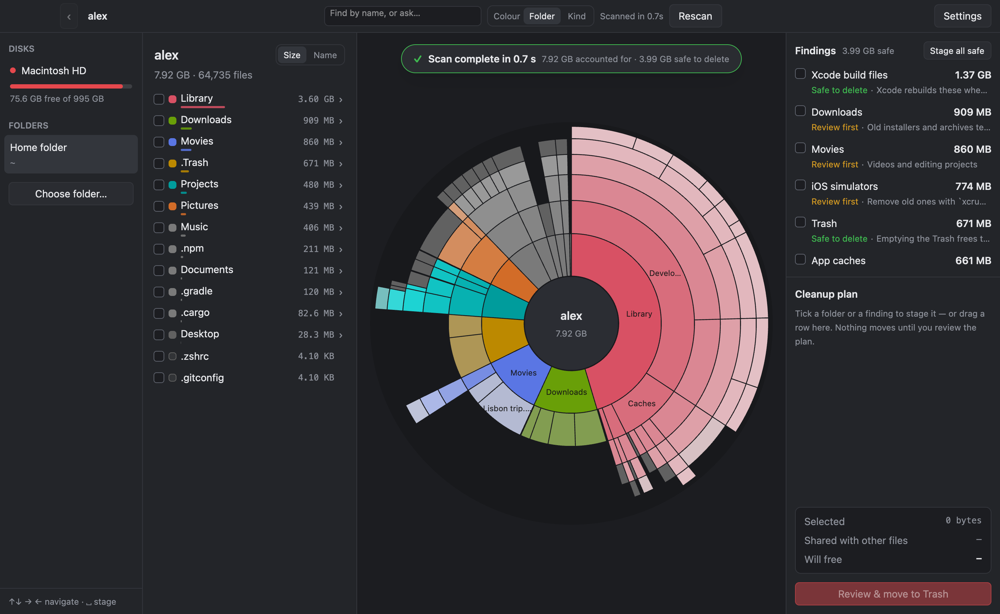

<p align="center">
  
</p>

<h1 align="center">Broom</h1>

<p align="center">
  <b>Ask your Mac what's eating the disk. Tick what should go. Trash it.</b><br>
  A menu-bar panel that understands plain English, over a fast, exact disk explorer with a live sunburst.<br>
  Native macOS, written in Rust, GPU-rendered, no analytics, nothing leaves the machine but the question you typed.
</p>

<p align="center">
  <a href="https://github.com/sriinnu/broom/actions/workflows/ci.yml"></a>
  
  
  <a href="LICENSE"></a>
</p>

---

Click the 🧹 in the menu bar and type what you mean: *node modules*, *all dist folders*,
*old dmg files in downloads*, *worktrees*, *xcode junk*. Broom turns that into groups of folders it
found on the last scan, labels each one **safe** or **review**, shows what deleting them really frees,
and moves what you tick to the Trash. Nothing is deleted outright.

The main window is the full picture: a sunburst of the disk that draws while the scan runs, findings
for the usual space hogs, and a cleanup plan you stage with checkboxes before anything moves.

<p align="center">
  
</p>

<p align="center">
  
</p>

<sub>Both screenshots use a made-up home folder generated by
[`scripts/make-demo-home.py`](scripts/make-demo-home.py), not anyone's real files.</sub>

## What it does

- **Search and clean from the menu bar.** The 🧹 panel takes a line of text, in English or in the
  Telugu you'd type on a phone (*node modules anni teesey*), and answers with groups: a finding from
  the catalog, every folder with that name, a file extension, git worktrees, or a name pattern. Each
  group expands to its folders with sizes and a reveal-in-Finder button.
- **Safe or review, with a reason.** `node_modules` next to a `package.json` is safe; a `dist` folder
  is "review" because not every `dist` is build output. Broom says why in one line and never
  pre-ticks a group it only matched by name.
- **Real savings.** On APFS, deleting a cloned or hard-linked file may free nothing. The number next
  to **Move to Trash** counts clones and hard links once, and is tested against real deletions on a
  throwaway APFS volume.
- **A reader, optionally.** With a [Jev](https://typesafe.ai) key, each group gets a yes/no from the
  classifier before it is offered as "safe"; with a chat-model key, free-form questions get a
  second opinion on what you meant. Both are off without keys, and Broom works fully without them.
  The model sees folder names and your question, never full paths.
- **Live from the first second.** The chart appears straight away and fills in as Broom reads.
  Folders turn from muted to full colour the moment their total is final, and you can click into
  them before the scan finishes.
- **Fast and exact.** A whole Mac (about 6 million files) in roughly 25 seconds; a home folder in a
  few seconds. Sizes are allocated blocks, so they match Finder's "on disk". For the startup disk,
  every other APFS volume gets an exact slice, so the chart adds up to the disk's used space to the
  byte. The [performance notes](docs/PERFORMANCE.md) have the measurements.
- **Findings.** Trash, Downloads, Xcode build files and archives, iOS device support and
  simulators, iPhone backups, Docker, app caches, npm, Cargo, Gradle, Movies, Mail, `node_modules`,
  Chrome's update leftovers. Each is **Safe to delete** or **Review first**, with a one-line reason.
- **A cleanup plan, not a delete button.** Tick folders, findings or panel groups to stage them. The
  plan shows what's selected, what's shared with other files, and what will actually free. **Review
  & move to Trash** lists every path once more before anything moves, and then the folders tumble
  into a little bin while the real move runs. Finder does the move, so **Put Back** works; the few
  folders Finder refuses (very large `node_modules`, say) go through NSFileManager instead.
- **It keeps up with Finder.** Empty the Trash, or drop something into it, and the Trash finding,
  the folder's slice and the disks' free space follow within a couple of seconds, no rescan.
- **Five looks.** **Settings › Appearance** switches between Classic (the default), Darkroom,
  Ledger, Console and Bloom. All but Classic come in light and dark, and can follow macOS.
- **Safe by design.** Broom only reads file metadata, never downloads cloud-only files, never
  sends anything over the network except the optional classifier calls, and has no analytics.
- **The investigator.** While a scan runs, a small ligne-claire investigator sniffs around with a
  magnifier and reports what it's seeing. Purely decorative, and the best part.

## Install

### Homebrew

```bash
brew install sriinnu/tap/broom
```

That installs **Broom** into /Applications and puts the `broom` command on your PATH. `brew upgrade`
picks up new releases; `brew uninstall --zap broom` also removes its settings.

### Build from source

**You need:** macOS 13 or later on Apple silicon, the Xcode Command Line Tools
(`xcode-select --install`), and [Rust](https://rustup.rs). The toolchain is pinned in
`rust-toolchain.toml`, so `rustup` fetches the right version.

```bash
git clone git@github.com:sriinnu/broom.git
cd broom
scripts/bundle.sh
```

That builds `dist/Broom.app`, signed ad hoc, so it runs on the Mac that built it. Drag it into
**Applications** and open it. `scripts/bundle.sh --dmg` also makes a disk image, and
`scripts/deploy.sh` builds and installs straight into /Applications.

Or run it from the source tree:

```bash
cargo run --release
```

### Releases

Tagged releases are built, signed with a Developer ID, notarized by Apple and published by the
Release workflow; see [docs/RELEASING.md](docs/RELEASING.md). Download the DMG from the
[Releases page](https://github.com/sriinnu/broom/releases), open it, drag **Broom** into
**Applications**. Each release lists its SHA-256 in `SHA256SUMS`, and
`gh attestation verify Broom-<version>.dmg -R sriinnu/broom` checks it was built by that workflow.

### Full Disk Access

macOS keeps some folders private (Mail, Messages, Safari, other apps' data) unless an app has Full
Disk Access. Broom works without it, shows exactly how much it couldn't read, and offers a button
that opens **System Settings › Privacy & Security › Full Disk Access**. Turn Broom on there; Broom
notices within a couple of seconds and offers to rescan. Access is tied to the app's signature, so a
rebuilt ad-hoc app has to be granted again.

When you run Broom from a terminal (`cargo run`), macOS asks about the terminal app instead.

### The reader (optional)

Broom's own matcher handles the common questions on its own. To turn on the classifier, open
**Settings › API keys** in the app and paste a key; it goes into the macOS keychain, never a file.
Under `cargo run`, the environment works too:

| Variable | Used for |
|---|---|
| `TYPESAFE_API_KEY` (or `JEV_API_KEY`) | Jev, the yes/no reader: "is this group what they asked for, and is it safe?" |
| `LAYA_API_KEY` (or `AI_GATEWAY_API_KEY`) | a chat model for free-form questions; `LAYA_BASE_URL` and `LAYA_MODEL` override the endpoint |

## Using Broom

**Menu bar.** Click 🧹 to open the panel (the number next to it is how full the startup disk is).
Type, then tick. `Enter` asks the reader when one is configured, `Esc` closes. Right-click or
ctrl-click the 🧹 for the menu: open the window, rescan, quit.

**Window.** Pick a disk or folder on the left. Hover a slice or a row to see its size; click to zoom
in; click the centre, or use the breadcrumbs, to go back up. Tick a folder or a finding to stage it,
or drag it onto the plan. The search box at the top takes the same questions the panel does.

Sort the list by Size, Name or Modified; click the same one again to flip it (↓/↑, A–Z/Z–A,
Newest/Oldest). Drag the edge of any column to resize it; double-click the edge to reset it. The ⎘ by
the breadcrumbs copies the open folder's path, and hovering a path that's cut short shows all of it.

Broom remembers each scan (folder sizes only, for a week), so scanning the same place again shows
what grew since: `+1.2 GB` in amber beside a folder, shrinkage in green. Once a scan finishes,
identical copies of your own files show up as a **Duplicate files** finding (compared byte for
byte; APFS clones and hard links don't count, since deleting them frees nothing). After a move to
the Trash, the banner has a **Put back** button for a few seconds.

| Keys | Action |
|---|---|
| ⌘F | Search or ask |
| ↑ ↓ | Move the selection |
| → or Enter | Open the selected folder |
| ← , ⌫, Esc or ⌘↑ | Go to the enclosing folder |
| Space | Stage or unstage the selected row |
| ⌘C | Copy the selected row's path (or the open folder's) |
| ⇧⌘C | The same, with your home folder as `~` |
| / | Search or ask |
| ⌘1 ⌘2 ⌘3 | Sort by size, name, date modified (again to flip) |
| ⌘O | Choose a folder to scan |
| ⌘R | Rescan |
| ⇧⌘D | Back to the Disks screen |
| ⌘, | Settings |
| ⌘Q | Quit |

You can also pass a folder on the command line: `broom ~/Library`. Broom runs as one instance: a
second launch hands its folder to the running one, brings it forward and exits.

## From a terminal, or an agent

The same scanner, ask engine and safety rules, without the window. Everything goes to the Trash,
never deleted outright; `clean` and `trash` are dry runs unless you add `--yes`. `--json` puts one
object on stdout for a program to read, progress stays on stderr.

```bash
broom scan                                  # home folder: totals, biggest folders, findings
broom scan ~/Library --json
broom find node modules and dist folders    # the groups the panel would show, with every path
broom find worktrees --root ~/Code --json
broom clean node modules                    # dry run: what would go, and what it frees
broom clean node modules --yes              # safe, precise groups only
broom clean old dmg in downloads --all --yes   # include "review" groups too
broom trash ~/Projects/x/node_modules ~/Library/Caches/pnpm --yes
```

`find --json` returns `groups[]` with `label`, `safety` (`safe` or `review`), `precise` (a name,
finding, extension or worktree match rather than a substring or kind guess), `bytes` and
`folders[]` of `{path, bytes, items}`. An agent reads that, decides, and calls `trash` with the
exact paths it wants; `clean --yes` is the shortcut for "everything precise and safe". `--ask` on
`find` or `clean` also consults the configured reader and reports its answer. The CLI refuses the
disk root, system folders, volumes, your home folder and its standard folders, and any Trash.
Exit codes: 0 done, 1 something failed (partial failures list what didn't move), 2 usage.

## How it works

```
src/
├── main.rs        app setup, menus, key bindings, command-line flags
├── cli.rs         headless scan / find / clean / trash for scripts and agents
├── app.rs         the window: disks rail, folder list, sunburst, findings, cleanup plan, review
├── panel.rs       the menu-bar panel: query, groups, ticks, confirm, trash
├── menubar.rs     the NSStatusItem (objc2), its menu, and where to hang the panel
├── ask/           turning a question into groups: tokens, folder words, findings, worktrees,
│   ├── mod.rs       patterns, kinds; dedupe; safety; the provider interface
│   ├── jev.rs       Jev (typesafe.ai) yes/no questions per group
│   └── laya.rs      chat-completion second opinion
├── classify/      what kind of thing a path is (apps, caches, photos…), colours the chart by kind
├── comic.rs       the investigator and the captions
├── trashcan.rs    the drop (folders tumbling into the bin) and the Finder-then-NSFileManager move
├── single.rs      one Broom at a time: a Unix socket in the state folder hands a second launch over
├── scan.rs        parallel walk (outline → hotspots → depth-first), the flat Tree, names index, frees_of
├── dirlist.rs     getattrlistbulk/openat directory listing, with a portable fallback
├── live.rs        live per-folder totals during a scan, snapshots
├── disk.rs        the startup disk's APFS container: exact slices for the other volumes
├── findings.rs    the catalog of known space hogs and how to recognise them
├── sunburst.rs    layout in angle space, painting, polar hit-testing
├── theme.rs       the five themes: palettes for light and dark, radius, fonts, the six-hue ladder
├── settings.rs    settings file and state dir
├── secrets.rs     keychain
├── onboarding.rs  first run and Full Disk Access detection
├── motion.rs      easing segments between live snapshots
├── eta.rs         progress and "about N s left"
├── clock.rs       the UI clock (lets the recorder pause time)
└── snapshot.rs    dev tool: scripted input, screenshots and video recording
```

1. **Outline.** The first two levels are listed by name in about 10 ms, so the chart has a shape at once.
2. **Hotspots.** Known space hogs are read next, in parallel, so findings and the biggest slices are
   exact within a couple of seconds even on a full disk.
3. **Main walk.** Everything else, depth-first across all cores. Folders in the top levels keep
   atomic running totals the UI snapshots ten times a second.
4. **Results.** The finished tree is a flat array of nodes with a lowercase name index, which is
   what makes a panel query over two million nodes answer in well under a second. Findings resolve
   their exact savings afterwards, one at a time on a small pool so they never starve the UI.
5. **Ask.** A query becomes tokens (stop words in English and Telugu dropped, phrases normalised),
   then groups: findings by alias, folder words from a table that knows which names need a manifest
   next to them to count as safe, extensions, worktrees (a folder whose `.git` is a file), glob
   patterns and kinds. Overlapping groups collapse to the most precise. If a reader is configured,
   it votes on each group and is only trusted above a confidence floor.

The UI is built with [GPUI](https://github.com/gpui-ce/gpui-ce) (the community edition of the
framework behind the Zed editor), which renders everything on the GPU with Metal. The menu-bar item
is an `NSStatusItem` through objc2, and the panel is a non-activating panel window hung under it.

## Development

```bash
cargo test                                        # unit tests, including the ask engine
cargo test -- --ignored                           # plus the APFS clone-accounting test (creates and deletes a small disk image)
cargo run --release -- --bench-scan ~/Library 6   # headless scan benchmark (median of 6)
cargo run --release -- --bench-live ~/Library 3   # how soon the live chart looks right
cargo run --release -- --check-access             # does this process have Full Disk Access?
```

`bench/ab.sh` runs two builds alternately and compares their medians. See
[docs/PERFORMANCE.md](docs/PERFORMANCE.md).

Dev hooks: `BROOM_OPEN_PANEL=1` pops the panel shortly after launch, `BROOM_PANEL_QUERY=…`
pre-fills it, `BROOM_MB_DEBUG=1` logs menu-bar and query timings and the paths sent to the Trash,
`BROOM_NO_SINGLETON=1` lets a second instance run (snapshot and video runs are exempt anyway).

### Screenshots and video without Screen Recording permission

With `--features snapshot`, Broom drives its own windows from a script and saves PNGs, or records a
video (needs `ffmpeg`). The screenshots above were made like this:

```bash
scripts/make-demo-home.py /tmp/demo
HOME=/tmp/demo/alex BROOM_HIDE_ACCESS=1 BROOM_SNAPSHOT=/tmp/shots/readme \
BROOM_SCRIPT="until-done 40; wait 2; shot main; panel; wait 1.5; panel-type node modules and dist folders; wait 5; panel-shot panel; quit" \
cargo run --release --features snapshot -- /tmp/demo/alex
```

Steps: `wait S`, `shot NAME`, `burst NAME COUNT MS`, `move X Y`, `click`, `hover`, `glide X Y S`,
`until-done MAX`, `about`, `panel`, `panel-type WORDS`, `panel-click X Y`, `panel-shot NAME`,
`panel-burst NAME COUNT MS`, `slow-motion N`, `hide-pointer`, `show-pointer`, `quit`. Coordinates are points within the window. For video, set
`BROOM_VIDEO=/tmp/broom.mp4` instead of `BROOM_SNAPSHOT`.

### Packaging for other Macs

`scripts/bundle.sh` signs ad hoc by default. To distribute, sign with a Developer ID and notarize:

```bash
BROOM_SIGN_ID="Developer ID Application: Your Name (TEAMID)" BROOM_NOTARY_PROFILE=broom-notary scripts/bundle.sh --dmg
```

(Save the notary profile once with `xcrun notarytool store-credentials broom-notary`.) The Release
workflow does the same from repository secrets; see [docs/RELEASING.md](docs/RELEASING.md).

### The icon

`scripts/make-icon.py` draws the investigator in ligne claire (flat fills, one contour weight, no
gradients or gloss) with the character's own palette from `src/comic.rs`, and builds
`packaging/AppIcon.icns` plus a size sheet:

```bash
uv run --with pillow python3 -I scripts/make-icon.py packaging
```

## Credits

- Broom is inspired by [Petal](https://github.com/henrydennis/petal) by Henry Dennis, and started
  as a fork of it.
- The sunburst idea goes back to [DaisyDisk](https://daisydiskapp.com). Broom is an independent
  project, not affiliated with it.
- Built on [GPUI CE](https://github.com/gpui-ce/gpui-ce), [rayon](https://github.com/rayon-rs/rayon),
  [objc2](https://github.com/madsmtm/objc2), [palette](https://github.com/Ogeon/palette) and
  [trash](https://github.com/Byron/trash-rs).

## License

[MIT](LICENSE)
